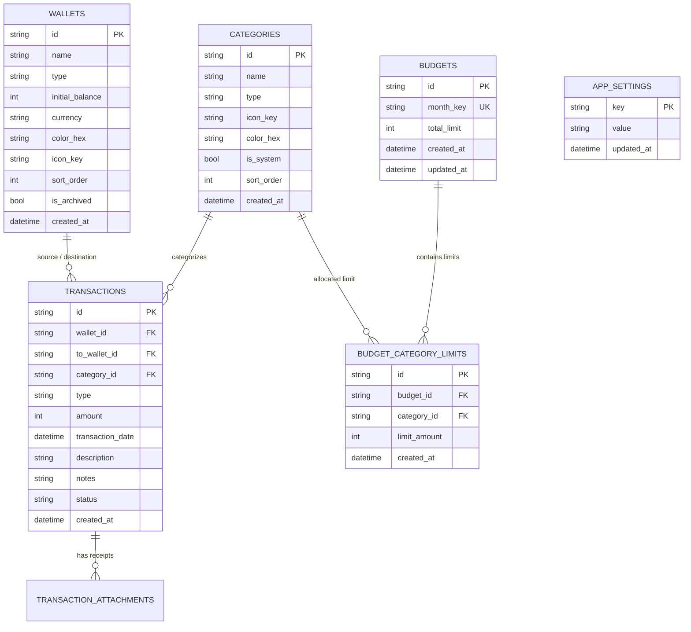
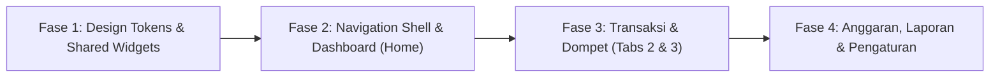

# DOKUMEN ANALISIS KOMPREHENSIF PROYEK MYFINANCE
**Persiapan Redesign UI/UX: Minimalis, Modern, Clean & Premium**

*Dokumen ini disusun sebagai panduan teknis dan arsitektural sebelum tahap redesign UI/UX dijalankan. Seluruh kode sumber, basis data, logika bisnis, dan dependensi tetap utuh tanpa perubahan pada tahap analisis ini.*

---

## 1. Ringkasan Eksekutif & Karakteristik Proyek

**MyFinance** adalah aplikasi pencatatan dan manajemen keuangan pribadi (*personal finance tracker*) berbasis **Local-First & Privacy-Focused** yang dirancang dengan pedoman visual **Apple Human Interface Guidelines (HIG)** dan didukung oleh kompilasi multiplatform (iOS native & Flutter Web).

### Karakteristik Kunci Sistem:
- **100% Offline & Private**: Seluruh data tersimpan secara lokal pada basis data terenkripsi lokal perangkat (Drift SQLite pada native & IndexedDB/Wasm SQLite pada Web). Tidak ada server eksternal, cloud database, atau analitik pihak ketiga.
- **Single Source of Truth Saldo**: Perhitungan saldo aset menggunakan integer penuh (*Integer Rupiah*, tanpa floating-point) berbasis agregasi transaksi ganda (*double-entry bookkeeping principles*).
- **Arsitektur Modular**: Mengadopsi prinsip **Clean Architecture** yang dipadukan dengan pengelompokan folder **Feature-First**.

---

## 2. Project Architecture (Arsitektur Sistem)

MyFinance memisahkan kode ke dalam tiga layer utama di setiap modul fiturnya:

```
┌────────────────────────────────────────────────────────┐
│                   PRESENTATION LAYER                   │
│   Screens, BottomSheets, Modal Dialogs, Reusable Cards │
│   State Management: Riverpod (StateNotifier / Streams)  │
└───────────────────────────┬────────────────────────────┘
                            │
┌───────────────────────────▼────────────────────────────┐
│                      DOMAIN LAYER                      │
│   Entities, Value Objects, Use Cases, Repository Specs │
│   (100% Bebas Dependensi Eksternal / Flutter Framework) │
└───────────────────────────┬────────────────────────────┘
                            │
┌───────────────────────────▼────────────────────────────┐
│                       DATA LAYER                       │
│   Repository Implementations, Models (JSON / Drift),   │
│   DAOs, Tables, Services (OCR, Backup, Auth, Storage)  │
└────────────────────────────────────────────────────────┘
```

1. **Presentation Layer**:
   - Berisi UI (Widget, Screen, Sheet) dan State Management.
   - Menggunakan **Flutter Riverpod** (`StateNotifierProvider`, `StreamProvider`, `FutureProvider`, `StateProvider`).
   - Widget pasif mendengarkan perubahan data melalui stream reaktif Drift, sehingga UI selalu sinkron secara *real-time*.
2. **Domain Layer**:
   - Memuat aturan bisnis murni (*pure business logic*), entitas data immutabel, dan kontrak *repository interface*.
   - Tidak memiliki dependensi ke Flutter UI, SQLite, atau framework luar.
3. **Data Layer**:
   - Mengimplementasikan repository dari domain layer.
   - Menangani komunikasi dengan basis data lokal **Drift SQLite**, parser berkas (JSON backup/restore, PDF/CSV exporter), serta servis hardware lokal (Camera OCR, WebAuthn/Biometrics).

---

## 3. Struktur Direktori Proyek

```text
lib/
├── main.dart                               # Entry point aplikasi & inisialisasi binding
├── app/
│   ├── app.dart                            # MyFinanceApp (MaterialApp.router, frame simulator web, AppLock)
│   ├── app_providers.dart                  # Registrasi global Riverpod Providers (DB, DAOs, Repos, Controllers)
│   ├── router.dart                         # Definisi rute GoRouter (StatefulShellRoute & standalone routes)
│   ├── scaffold_with_nav_bar.dart          # Shell Scaffold dengan Bottom Navigation Bar & FAB Quick Action
│   └── lifecycle_observer.dart             # Pemantau state lifecycle (background/foreground)
├── core/
│   ├── constants/
│   │   ├── app_constants.dart              # Nama app, versi, batas minimum, konstanta string
│   │   └── currency_constants.dart         # Simbol Rp, kode IDR, locale id_ID
│   ├── database/
│   │   ├── app_database.dart               # Kelas utama Drift SQLite (schemaVersion 2, migrasi onUpgrade)
│   │   ├── connection/
│   │   │   ├── connection.dart             # Koneksi native SQLite (sqlite3_flutter_libs)
│   │   │   └── connection_web.dart         # Koneksi web SQLite (ResilientWebStorage / IndexedDB Wasm)
│   │   ├── daos/
│   │   │   ├── app_settings_dao.dart       # DAO pengaturan (kunci aplikasi, PIN hash, biometrik, tema)
│   │   │   ├── budgets_dao.dart            # DAO anggaran bulanan & batas kategori
│   │   │   ├── categories_dao.dart         # DAO kategori transaksi (income/expense)
│   │   │   ├── transactions_dao.dart       # DAO mutasi transaksi & attachment
│   │   │   └── wallets_dao.dart            # DAO dompet & rekening kas
│   │   └── tables/
│   │       ├── app_settings_table.dart     # Tabel kv-store konfigurasi lokal
│   │       ├── budget_category_limits_table.dart # Tabel alokasi nominal per kategori per anggaran
│   │       ├── budgets_table.dart          # Tabel master anggaran bulanan (total limit, month_key)
│   │       ├── categories_table.dart       # Tabel kategori (icon, warna, sistem/kustom)
│   │       ├── transaction_attachments_table.dart # Tabel metadata lampiran struk
│   │       ├── transactions_table.dart     # Tabel transaksi mutasi & transfer
│   │       └── wallets_table.dart          # Tabel dompet/akun keuangan
│   ├── errors/
│   │   ├── exceptions.dart                 # Definisi exception data source
│   │   └── failures.dart                   # Definisi failure domain layer
│   ├── extensions/
│   │   ├── currency_extension.dart         # Ekstensi int to Rupiah
│   │   └── date_extension.dart             # Ekstensi DateTime formatting
│   ├── formatting/
│   │   ├── currency_formatter.dart         # Parser & formatter integer Rupiah
│   │   └── date_formatter.dart             # Formatter tanggal & month_key (YYYY-MM)
│   ├── services/
│   │   ├── app_lock_service.dart           # Layanan biometrik, SHA-256 PIN hashing & verification
│   │   ├── web_auth_helper.dart            # Penghubung WebAuthn API untuk web browser
│   │   ├── web_auth_helper_stub.dart       # Stub WebAuthn untuk mobile
│   │   └── web_auth_helper_web.dart        # Implementasi JS interop WebAuthn Safari/Chrome
│   ├── theme/
│   │   ├── app_colors.dart                 # Palet warna semantik Light/Dark HIG (Emerald, Crimson, Navy)
│   │   ├── app_icons.dart                  # Pemetaan icon key ke Material Icons & parser hex warna
│   │   ├── app_spacing.dart                # Skala grid 8-point & border radii HIG
│   │   ├── app_typography.dart             # Skala tipografi San Francisco (body 17, headline, display)
│   │   └── app_theme.dart                  # ThemeData Light & Dark terkonfigurasi
│   └── utils/
│       ├── app_haptics.dart                # Umpan balik haptic (light, medium, heavy, selection)
│       ├── file_export_helper.dart         # Helper download berkas web / native share
│       └── file_picker_helper.dart         # Helper pemilihan berkas lokal (JSON backup)
├── features/
│   ├── backup_restore/                     # Cadangkan, validasi integritas, & pulihkan data JSON
│   ├── budgets/                            # Alokasi anggaran bulanan, limit per kategori, peringatan overbudget
│   ├── categories/                         # Manajemen kategori pemasukan & pengeluaran
│   ├── dashboard/                          # Halaman beranda (Home) ringkasan finansial utama
│   ├── receipt_scanner/                    # OCR scanner struk belanja on-device (Tesseract Wasm)
│   ├── reports/                            # Laporan analitik bulanan, grafik arus kas, ekspor PDF/CSV
│   ├── security/                           # Kunci aplikasi PIN 6-digit Apple-style, Face ID / Touch ID
│   ├── settings/                           # Preferensi aplikasi, tema, keamanan, reset data
│   ├── transactions/                       # Pencatatan mutasi transaksi, filter, pencarian, void transaksi
│   └── wallets/                            # Pengelolaan dompet, saldo awal, transfer antar dompet
└── shared/
    └── widgets/
        ├── app_button.dart                 # Tombol aksi utama dengan state loading
        ├── app_card.dart                   # Kontainer kartu standar HIG dengan border halus
        ├── app_text_field.dart             # Input teks standar dengan label & error
        ├── empty_state.dart                # Tampilan status kosong (empty illustrations)
        └── loading_indicator.dart          # Spinner indikator proses asinkron
```

---

## 4. Daftar Seluruh Screen, Dialog & Modal

Aplikasi memiliki **7 Screen Utama**, **6 BottomSheet Fungsional**, dan **3 Modal Khusus**:

| No | Tipe Tampilan | File Path | Rute / Pemicu | Deskripsi & Fungsi |
| :--- | :--- | :--- | :--- | :--- |
| 1 | **Screen (Tab 1)** | `lib/features/dashboard/presentation/screens/dashboard_screen.dart` | `/` (Home) | Halaman beranda ringkasan saldo kas aktif, tombol aksi cepat, kartu anggaran bulanan, widget dompet, dan mutasi terkini. |
| 2 | **Screen (Tab 2)** | `lib/features/transactions/presentation/screens/transactions_screen.dart` | `/transactions` | Daftar lengkap riwayat mutasi keuangan dengan tab filter (Semua, Pengeluaran, Pemasukan, Transfer), search bar, dan fungsi void. |
| 3 | **Screen (Tab 3)** | `lib/features/wallets/presentation/screens/wallets_screen.dart` | `/wallets` | Manajemen akun dompet & rekening bank/e-wallet, total saldo aset kumulatif, dompet aktif vs diarsipkan. |
| 4 | **Screen (Tab 4)** | `lib/features/reports/presentation/screens/reports_screen.dart` | `/reports` | Laporan analitik keuangan bulanan, visualisasi grafik diagram batang/garis (`fl_chart`), perbandingan pemasukan vs pengeluaran, dan tombol ekspor. |
| 5 | **Screen (Standalone)** | `lib/features/budgets/presentation/screens/budgets_screen.dart` | `/budgets` | Detail pemantauan anggaran bulanan, persentase pengeluaran, batas pengeluaran per kategori, dan peringatan *overbudget*. |
| 6 | **Screen (Standalone)** | `lib/features/settings/presentation/screens/settings_screen.dart` | `/settings` | Pengaturan preferensi: tema (Terang/Gelap/Sistem), mata uang, kunci keamanan biometrik/PIN, ekspor dokumen, dan cadangan data. |
| 7 | **Screen (Standalone)** | `lib/features/backup_restore/presentation/screens/backup_restore_screen.dart` | `context.push` via Settings | Antarmuka pembuatan arsip JSON terstruktur, pemulihan data dari clipboard/file, dan zona reset database. |
| 8 | **Screen (Overlay)** | `lib/features/security/presentation/widgets/app_lock_screen.dart` | Terpicu otomatis jika `!isUnlocked` | Layar proteksi keamanan penuh dengan keypad numerik PIN 6-digit dan tombol pemicu biometrik Face ID / Touch ID. |
| 9 | **Screen (Modal)** | `lib/features/receipt_scanner/presentation/screens/receipt_scanner_screen.dart` | `/receipt-scanner` | Layar pemindai kamera struk fisik atau pengunggah gambar dari galeri/berkas untuk diproses OCR. |
| 10 | **Screen (Modal)** | `lib/features/receipt_scanner/presentation/screens/receipt_review_screen.dart` | Setelah proses OCR | Peninjauan draf transaksi hasil pembacaan OCR, koreksi nominal, penetapan dompet & kategori, serta konfirmasi pencatatan. |
| 11 | **BottomSheet** | `lib/app/scaffold_with_nav_bar.dart` (`_showQuickActionModal`) | Tombol `+` di Bottom Navigation | Menu popup tindakan cepat: Catat Pengeluaran, Catat Pemasukan, Transfer Saldo, Atur Anggaran, dan Scan Struk. |
| 12 | **BottomSheet** | `lib/features/transactions/presentation/widgets/add_transaction_sheet.dart` | Pemicu transaksi | Formulir entri transaksi lengkap: tipe (Pemasukan, Pengeluaran, Transfer), nominal Rupiah, dompet sumber/tujuan, kategori, tanggal, catatan, dan foto struk. |
| 13 | **BottomSheet** | `lib/features/budgets/presentation/screens/budgets_screen.dart` (`_SetBudgetSheet`) | "Atur Anggaran" | Formulir penetapan batas total anggaran bulanan dan alokasi limit opsional per kategori pengeluaran. |
| 14 | **BottomSheet** | `lib/features/wallets/presentation/screens/wallets_screen.dart` (`_AddWalletModal`) | "Tambah Dompet" | Formulir pembuatan akun dompet baru: nama dompet, tipe (Tunai, Bank, E-Wallet, Kartu Kredit, Tabungan), saldo awal, ikon, dan warna. |
| 15 | **BottomSheet** | `lib/features/wallets/presentation/screens/wallets_screen.dart` (`_TransferBalanceModal`) | "Transfer Saldo" | Formulir pemindahan dana antar dompet internal maupun pengiriman ke bank/e-wallet eksternal. |
| 16 | **BottomSheet** | `lib/features/reports/presentation/widgets/export_sheet.dart` | "Ekspor Laporan" | Pilihan format ekspor dokumen: PDF cetak siap simpan atau CSV tabular untuk spreadsheet. |
| 17 | **BottomSheet** | `lib/features/security/presentation/widgets/pin_setup_sheet.dart` | Pengaturan PIN | Lembar alur 2 langkah setup PIN baru (buat 6 digit lalu konfirmasi 6 digit) dengan umpan balik haptic. |
| 18 | **BottomSheet** | `lib/features/security/presentation/widgets/pin_verify_sheet.dart` | Verifikasi Keamanan | Lembar verifikasi PIN sebelum tindakan sensitif (ubah PIN atau matikan proteksi). |

---

## 5. Daftar Fitur Per Screen

### A. DashboardScreen (`/`)
- **Total Saldo Bersih**: Menampilkan total saldo likuid dari seluruh dompet aktif (tidak termasuk dompet yang diarsipkan).
- **Aksi Cepat Cepat**: Tombol *shortcut* satu ketukan untuk Pengeluaran (Merah), Pemasukan (Hijau), dan Transfer (Biru).
- **Monthly Financial Overview**: Kartu rangkuman arus kas bulan berjalan (Total Pemasukan, Total Pengeluaran, Arus Kas Bersih, dan Bar Indikator Anggaran).
- **Dompet & Rekening Horisontal**: Slider horizontal kartu-kartu dompet aktif beserta sisa saldo masing-masing.
- **Transaksi Terkini**: Daftar 20 mutasi terakhir dengan ikon kategori, status void (dicoret jika dibatalkan), dan waktu transaksi.
- **RefreshIndicator**: Tarik ke bawah untuk memperbarui seluruh stream data.

### B. TransactionsScreen (`/transactions`)
- **Pencarian Real-Time**: Input teks untuk mencari mutasi berdasarkan deskripsi transaksi, nama kategori, atau nama dompet.
- **Filter Segmented Tabs**: Filter cepat transaksi berdasarkan: Semua, Pengeluaran, Pemasukan, dan Transfer.
- **Detail Transaksi & Status Void**: Mengetuk transaksi memunculkan detail opsi pembatalan transaksi (*void transaction*) dengan catatan alasan.
- **FAB Tambah Transaksi**: Akses instan membuka lembar pencatatan mutasi baru.

### C. WalletsScreen (`/wallets`)
- **Total Saldo Aset**: Menghitung seluruh kekayaan aset (dompet aktif + dompet diarsipkan).
- **Pengelompokan Dompet**: Bagian "Dompet Aktif" dan bagian "Dompet Diarsipkan" (bisa di-*expand/collapse*).
- **Aksi Kelola Dompet**: Tambah dompet baru, edit rincian dompet, transfer saldo, serta arsipkan/buka arsip dompet.
- **Pilihan Fleksibel Tujuan Transfer**: Mendukung transfer antar dompet terdaftar maupun pengeluaran transfer ke bank/orang lain di luar sistem.

### D. ReportsScreen (`/reports`)
- **Navigasi Bulan Interaktif**: Tombol panah bulan sebelumnya/berikutnya untuk meninjau riwayat laporan keuangan historis.
- **Kartu Ringkasan Finansial**: Total Pendapatan, Total Belanja, Saldo Arus Kas, dan Rasio Tingkat Tabungan (*Savings Rate %*).
- **Visualisasi Grafik Arus Kas (`fl_chart`)**: Bar chart perbandingan pendapatan vs pengeluaran bulanan.
- **Breakdown Alokasi Pengeluaran**: Distribusi pengeluaran per kategori yang terurut dari yang terbesar.
- **Ekspor Dokumen**: Tombol ekspor untuk men-generate dokumen laporan PDF formal dan berkas spreadsheet CSV.

### E. BudgetsScreen (`/budgets`)
- **Progress Anggaran Utama**: Indikator cincin persentase terpakai, sisa uang yang boleh dibelanjakan, dan status normal/warning/overbudget.
- **Alokasi Batas Per Kategori**: Rincian alokasi nominal belanja maksimal untuk kategori tertentu (misal: Makanan, Transportasi, Hiburan).
- **Peringatan Batas Alokasi**: Memberikan visual warning apabila total alokasi per kategori melebihi total batas anggaran bulanan.
- **Modal Atur Anggaran Aman Keyboard**: Dilengkapi padding dinamis `effectiveBottomPadding` untuk memastikan input nominal terbawah tidak tertutup oleh keyboard numerik iOS.

### F. SettingsScreen (`/settings`)
- **Pengaturan Tampilan / Tema**: Pilihan mode Terang (Light), Gelap (Dark), atau Mengikuti Sistem (System Adaptive).
- **Konfigurasi Mata Uang**: Default IDR (Rupiah Indonesia).
- **Kunci Keamanan Aplikasi**: Switch aktivasi PIN 6-digit & Biometrik (Face ID / Touch ID / WebAuthn), ubah PIN, dan tombol uji coba "Kunci Aplikasi Sekarang".
- **Akses Cadangkan & Pulihkan**: Menu navigasi menuju layar ekspor/impor arsip JSON.
- **Akses Ekspor Cepat**: Shortcut lembar ekspor dokumen laporan.

### G. BackupRestoreScreen
- **Cadangkan Data (Backup)**: Pembuatan berkas arsip JSON berisi seluruh tabel SQLite (dompet, kategori, transaksi, anggaran) dan penyalinan langsung ke clipboard.
- **Pulihkan Data (Restore)**: Validasi skema berkas JSON sebelum penerapan, kalkulasi pratinjau jumlah data, pembersihan otomatis text field saat navigasi ulang, dan penerapan pemulihan instan.
- **Zona Berbahaya (Reset)**: Tombol pembersihan seluruh data transaksi dan saldo kembali ke kondisi awal dengan konfirmasi ganda.

---

## 6. Katalog Komponen Reusable yang Sudah Ada

Aplikasi telah memiliki fondasi komponen reusable di [`lib/shared/widgets/`](file:///c:/laragon/www/app-finance/lib/shared/widgets/) dan beberapa widget modular di dalam folder fitur:

| Nama Widget | Lokasi Berkas | Properti Kunci | Penggunaan Saat Ini |
| :--- | :--- | :--- | :--- |
| **`AppButton`** | `shared/widgets/app_button.dart` | `label`, `onPressed`, `isLoading`, `isOutlined`, `icon`, `backgroundColor` | Tombol primer dan sekunder pada seluruh formulir (Simpan, Batal, Terapkan). |
| **`AppCard`** | `shared/widgets/app_card.dart` | `child`, `padding`, `onTap`, `borderRadius`, `color` | Kartu kontainer berlatar putih/gelap dengan border halus HIG. Digunakan di Home, Settings, Wallets, Budgets. |
| **`AppTextField`** | `shared/widgets/app_text_field.dart` | `controller`, `label`, `hint`, `errorText`, `keyboardType`, `prefixIcon` | Field input teks standar dengan border adaptif mode terang/gelap. |
| **`EmptyState`** | `shared/widgets/empty_state.dart` | `icon`, `title`, `message`, `actionLabel`, `onAction` | Tampilan placeholder saat data transaksi/dompet/laporan masih kosong. |
| **`LoadingIndicator`** | `shared/widgets/loading_indicator.dart` | `message` | Indikator tunggu dengan teks penjelasan status. |
| **`PinKeypad`** | `features/security/presentation/widgets/pin_keypad.dart` | `onDigitPressed`, `onDeletePressed`, `showBiometricButton`, `onBiometricPressed` | Papan ketik angka 1-9, 0, hapus, dan tombol biometrik bergaya tombol keypad Apple iOS. |
| **`PinDotsIndicator`** | `features/security/presentation/widgets/pin_dots_indicator.dart` | `pinLength` (6), `currentLength`, `hasError` | 6 titik lingkaran indikator PIN yang terisi dengan animasi mulus dan warna error merah saat salah. |
| **`MonthComparisonCard`** | `features/reports/presentation/widgets/month_comparison_card.dart` | `currentIncome`, `currentExpense`, `previousIncome`, `previousExpense` | Kartu komparasi performa keuangan antara bulan ini vs bulan lalu. |
| **`ConfidenceBadge`** | `features/receipt_scanner/presentation/widgets/confidence_badge.dart` | `confidence` (0.0 - 1.0) | Chip penanda tingkat keyakinan hasil pembacaan OCR teks struk belanja. |

---

## 7. State Management & Daftar Dependensi

### State Management: Flutter Riverpod (`flutter_riverpod: ^2.5.1`)
MyFinance menggunakan Riverpod secara konsisten tanpa mencampurnya dengan Bloc, Provider lama, atau GetX.

- **Singleton Services**: `databaseProvider`, `appLockServiceProvider`, `backupValidatorServiceProvider`.
- **DAOs**: `walletsDaoProvider`, `categoriesDaoProvider`, `transactionsDaoProvider`, `budgetsDaoProvider`, `appSettingsDaoProvider`.
- **Repositories**: `walletRepositoryProvider`, `transactionRepositoryProvider`, `budgetRepositoryProvider`, `reportRepositoryProvider`, `backupRepositoryProvider`.
- **Reactive Streams**:
  - `walletsWithBalanceStreamProvider`: Memantau dompet aktif beserta kalkulasi saldo real-time.
  - `archivedWalletsWithBalanceStreamProvider`: Memantau dompet yang diarsipkan.
  - `netOperationalBalanceProvider`: Menghitung saldo kas operasional (Home).
  - `totalAllAssetBalanceProvider`: Menghitung saldo aset total (Dompet & Rekening).
  - `recentTransactionsStreamProvider`: Memantau 20 mutasi transaksi terkini.
  - `budgetProgressStreamProvider(monthKey)`: Memantau sisa limit anggaran bulan tertentu.
  - `monthlyIncomeProvider(monthKey)` & `monthlyExpenseProvider(monthKey)`: Memantau agregat arus kas bulanan.
- **Controllers (`StateNotifier`)**:
  - `walletsControllerProvider`: Menangani penambahan, pengubahan, pengarsipan, dan transfer dompet.
  - `transactionsControllerProvider`: Menangani pencatatan mutasi, transfer, dan void transaksi.
  - `budgetsControllerProvider`: Menangani penetapan anggaran bulanan dan limit kategori atomik.
  - `backupRestoreControllerProvider`: Mengontrol alur validasi dan pemulihan arsip JSON.
  - `appLockControllerProvider`: Mengontrol status terkunci/terbuka, verifikasi PIN, dan biometrik.

### Daftar Dependensi Paket (`pubspec.yaml`)

| Paket | Versi | Peran dalam Aplikasi |
| :--- | :--- | :--- |
| `flutter_riverpod` | `^2.5.1` | State management reaktif, injeksi dependensi, pemantauan stream data. |
| `go_router` | `^14.2.0` | Routing deklaratif, deep linking, dan `StatefulShellRoute` (persistent bottom bar). |
| `drift` | `^2.18.0` | SQLite ORM lokal dengan type-safety tinggi, query builder, dan reaktif stream. |
| `sqlite3_flutter_libs` | `^0.5.24` | Bundling library binary SQLite native untuk iOS, macOS, Android, Windows. |
| `intl` | `^0.19.0` | Format penanggalan internasional dan parser waktu. |
| `fl_chart` | `^0.68.0` | Library grafik visualisasi data keuangan (diagram batang dan garis). |
| `local_auth` | `^2.2.0` | Autentikasi biometrik native perangkat (Face ID / Touch ID di iOS). |
| `crypto` | `^3.0.3` | Hashing kriptografi SHA-256 untuk penyimpanan kode sandi PIN. |
| `pdf` & `printing` | `^3.10.8` / `^5.13.1` | Pembuatan dokumen laporan PDF dan pratinjau cetak. |
| `csv` | `^6.0.0` | Format berkas ekspor tabular data keuangan. |
| `share_plus` | `^9.0.0` | Integrasi native iOS share sheet untuk membagikan berkas laporan/cadangan. |
| `camera` & `image_picker` | `^0.11.0+1` / `^1.1.2` | Pengambilan foto struk fisik melalui kamera perangkat atau galeri. |
| `uuid` | `^4.4.0` | Pembuatan ID unik UUID v4 untuk setiap record database. |
| `path_provider` & `path` | `^2.1.3` / `^1.9.0` | Resolusi direktori penyimpanan berkas lokal di perangkat. |
| `flutter_local_notifications` | `^17.2.1` | Notifikasi lokal (peringatan anggaran). |

---

## 8. Database & Alur Data (Drift SQLite Schema)

Aplikasi memiliki **7 Tabel Database** dengan skema versi 2 (`schemaVersion: 2`):



### Prinsip Alur Data Saldo:
1. Saldo dompet **TIDAK PERNAH** disimpan sebagai nilai statis yang dimutasi langsung (`UPDATE wallets SET balance = ...`).
2. Saldo dihitung secara dinamis dari **Saldo Awal (`initial_balance`)** ditambah akumulasi mutasi transaksi:
   $$\text{Saldo Dompet} = \text{initial\_balance} + \sum(\text{Pemasukan}) - \sum(\text{Pengeluaran}) - \sum(\text{Transfer Keluar}) + \sum(\text{Transfer Masuk})$$
3. Transaksi berstatus `voided` otomatis diabaikan dari kalkulasi saldo.
4. Nominal uang disimpan murni dalam integer Rupiah tanpa desimal (menghindari *floating point round-off error*).

---

## 9. Analisis Desain & Styling Saat Ini

### A. Skema Warna Saat Ini ([`AppColors`](file:///c:/laragon/www/app-finance/lib/core/theme/app_colors.dart))
- **Primary Navy Brand**: `#1E272E` (Navy Gelap) & `#2C3E50`.
- **Emerald Green (Income)**: `#0E7A4A` (Light) / `#2ED573` (Dark).
- **Crimson Red (Expense)**: `#D63031` (Light) / `#FF5252` (Dark).
- **Transfer / Accent Blue**: `#0984E3` (Light) / `#70A1FF` (Dark).
- **Surfaces**:
  - Light: Background `#F8F9FA`, Surface `#FFFFFF`, Border `#E5E7EB`.
  - Dark: Background `#0B0F14`, Surface `#151C24`, Card `#1E2833`, Border `#2D3B48`.

### B. Tipografi Saat Ini ([`AppTypography`](file:///c:/laragon/www/app-finance/lib/core/theme/app_typography.dart))
- Mengikuti skala tipografi standar iOS San Francisco (`largeTitle: 34`, `title1: 28`, `title2: 22`, `title3: 20`, `headline: 17`, `body: 17`, `subhead: 15`, `footnote: 13`, `caption1: 12`, `caption2: 11`).
- Tambahan khusus untuk angka finansial: `balanceLarge: 32`, `balanceMedium: 24`, `balanceSmall: 17`.

### C. Catatan Evaluasi Desain Saat Ini (Area Potensial Redesign):
1. **Visual Hierarchy & Spacing**:
   - Tampilan beranda (*Home*) saat ini memuat banyak kartu vertikal dengan kepadatan (*density*) yang seragam, sehingga kontras hierarki visual antara total saldo dan kartu ringkasan bulanan dapat dibuat lebih bernafas (*breathable*).
2. **Karakter "Premium & Modern"**:
   - Kartu-kartu masih menggunakan border kotak standar `1.0px` dengan sudut radius seragam `18.0px`. Desain premium modern dapat ditingkatkan dengan efek *subtle inner glow/shadows*, material kartu bertingkat (*layered cards*), atau aksen *glassmorphism* lembut yang terinspirasi dari Apple Design terkini.
3. **Bottom Navigation Bar**:
   - `BottomNavigationBar` masih berupa bar standar Material 3. Mengubahnya menjadi *floating capsule dock* atau bilah navigasi dengan blur translusen (*frosted glass*) akan secara instan mengangkat impresi premium aplikasi.
4. **Micro-Interactions & Visual Delight**:
   - Animasi transisi antar tab, progress bar indikator anggaran dengan efek gradient halus, dan kartu dompet horizontal yang lebih menyerupai kartu fisik modern (*luxury debit/credit card mockup*) akan memberikan nilai estetika tinggi.

---

## 10. Rekomendasi Strategi Redesign (Minimalis, Modern, Clean & Premium)

Untuk mencapai identitas desain yang **minimalis, modern, clean, dan premium**, redesign harus mengedepankan filosofi:
> *"Form follows function with refined simplicity: kurangi kekacauan visual (visual noise), tonjolkan tipografi angka keuangan dengan elegan, dan berikan ruang negatif yang lega."*

### A. Rencana Konseptual Desain Baru

```
┌────────────────────────────────────────────────────────┐
│  1. REFINED COLOR PALETTE                              │
│     - True OLED Dark surfaces (deep charcoal/zinc)     │
│     - Ultra-crisp Light surfaces (pure porcelain/off-w)│
│     - Muted luxury accent tones (Champagne / Sage /    │
│       Deep Emerald / Muted Coral)                      │
├────────────────────────────────────────────────────────┤
│  2. LUXURY CARD HIERARCHY                              │
│     - Hero Balance Card: Desain kartu premium          │
│       dengan subtle gradient & typography kontras      │
│     - Segmented Grouping bergaya iOS Inset Grouped     │
├────────────────────────────────────────────────────────┤
│  3. FLOATING FROSTED DOCK                              │
│     - Bottom navigation dengan latar blur translusen   │
│     - Ikon minimalis garis tipis dengan seleksi aktif  │
├────────────────────────────────────────────────────────┤
│  4. FLUID PROGRESS & CHARTS                            │
│     - Progress bar anggaran dengan ujung rounded halus │
│     - Grafik fl_chart dengan kurva lembut & tooltip    │
└────────────────────────────────────────────────────────┘
```

### B. Halaman yang Paling Cocok untuk Mulai Redesign

> **Rekomendasi Utama: Mulai dari `DashboardScreen` (Home) dan `ScaffoldWithNavBar` (Shell Navigasi)**

**Alasan Pemilihan:**
1. **First Impression**: Home adalah layar pertama yang dilihat pengguna setelah membuka aplikasi / melewati layar kunci.
2. **Pusat Identitas Visual**: Elemen-elemen di Home (kartu saldo, kartu ringkasan bulanan, slider dompet, tombol aksi, dan mutasi terkini) mencakup hampir seluruh varian komponen dasar aplikasi. Menuntaskan Home secara otomatis menetapkan bahasa desain (*design tokens*) untuk layar-layar lainnya.
3. **Komponen Navigasi Global**: Redesign `ScaffoldWithNavBar` (dock navigasi bawah dan quick action modal) langsung mentransformasi impresi visual di seluruh 4 tab aplikasi secara bersamaan.

### C. Tahapan Eksekusi Bertahap (Phased Roadmap)



1. **Fase 1 (Design Tokens & Shared Foundations)**:
   - Modernisasi `AppColors`, `AppSpacing`, dan `AppTypography`.
   - Redesign shared widgets: `AppCard`, `AppButton`, `AppTextField`, `EmptyState`.
2. **Fase 2 (Navigation Shell & Home)**:
   - Redesign `ScaffoldWithNavBar` menjadi dock navigasi modern/translusen.
   - Redesign `DashboardScreen` (Hero Balance Card, Arus Kas Bulanan, Dompet Slider, Quick Actions).
3. **Fase 3 (Transaksi & Dompet)**:
   - Redesign `TransactionsScreen` (filter pills modern, transaksi card item).
   - Redesign `WalletsScreen` (tampilan kartu dompet virtual premium, detail saldo).
   - Redesign `AddTransactionSheet` & Modal Transfer.
4. **Fase 4 (Anggaran, Laporan & Pengaturan)**:
   - Redesign `BudgetsScreen` & visual limit per kategori.
   - Redesign `ReportsScreen` & grafik arus kas `fl_chart`.
   - Redesign `SettingsScreen`, `AppLockScreen`, dan `BackupRestoreScreen`.

### D. Ketersediaan Aset Referensi Desain (`design_reference/`)
Proyek telah dilengkapi dengan **37 berkas tangkapan layar referensi UI/UX** di folder [`design_reference/`](file:///c:/laragon/www/app-finance/design_reference/) (`1.png` sampai `37.png`).
- Berkas referensi ini akan dipelajari dan dijadikan panduan visual spesifik untuk mereplikasi estetika minimalis, modern, clean, dan premium (layout kartu, kartu dompet, navigasi mengambang, filter chips, diagram keuangan, dan micro-interactions) saat eksekusi redesign dimulai.

---

## 11. Analisis Risiko Perubahan UI & Mitigasinya

Berikut adalah 6 risiko teknis krusial yang wajib dijaga selama proses redesign antarmuka:

| No | Risiko Teknis | Dampak Jika Terjadi | Tindakan Pencegahan / Mitigasi |
| :--- | :--- | :--- | :--- |
| 1 | **Gangguan Kompatibilitas Safari iPhone & Web** | Tampilan terpotong, touch target tidak responsif, atau error rendering CanvasKit. | Selalu pertahankan batasan `kIsWeb`, simulator frame PC (`constraints.maxWidth > 500`), dan touch target minimal 44x44 pt sesuai HIG. |
| 2 | **Keyboard Viewport Overlap (Numeric Keypad)** | Field input nominal di modal tertutup oleh papan ketik angka iPhone. | Pertahankan penggunaan `scrollPadding` (380px) dan perhitungan `effectiveBottomPadding = math.max(bottomInset + 120, 380.0)` pada setiap sheet formulir. |
| 3 | **Pemutusan Stream Reaktif Riverpod / Drift** | Saldo tidak terupdate saat ada mutasi baru, atau UI menjadi *stale*. | UI hanya boleh mengubah tata letak (`Widget build`), dilarang mengganti cara membaca provider (`ref.watch(...)`). Jangan memutus stream reaktif dari DAO. |
| 4 | **Perubahan Tipe Data Keuangan** | Terjadinya bug floating point (contoh: Rp 10.000,0000001) atau parsing error. | Tetap gunakan `int` Rupiah tanpa desimal dan selalu gunakan fungsi utilitas `CurrencyFormatter.formatRupiah` dan `parseRupiahToInt`. |
| 5 | **Bypass Kunci Keamanan (`AppLockListener`)** | Aplikasi tidak terkunci saat masuk background atau membuka aplikasi kembali. | `AppLockListener` harus tetap membungkus widget pohon teratas di `lib/app/app.dart`. Jangan pernah menghapus listener ini saat merombak layout shell. |
| 6 | **Regresi 72 Unit & Integration Tests** | Test suite otomatis mengalami kegagalan (*failed assertion*). | Pastikan *Key* widget penting (misal `key: Key('...')`) atau struktur semantic yang diuji oleh widget test tetap terjaga. |

---

## 12. Daftar File yang Akan Terdampak pada Tahap Redesign

### A. Berkas Fondasi Styling & Tokens (Akan Dimutasi):
1. [`lib/core/theme/app_colors.dart`](file:///c:/laragon/www/app-finance/lib/core/theme/app_colors.dart) — Penyesuaian palet warna premium, aksen mewah, dan kontras permukaan.
2. [`lib/core/theme/app_spacing.dart`](file:///c:/laragon/www/app-finance/lib/core/theme/app_spacing.dart) — Penyesuaian radius sudut, padding, dan metrik elevasi.
3. [`lib/core/theme/app_typography.dart`](file:///c:/laragon/www/app-finance/lib/core/theme/app_typography.dart) — Penyesuaian skala font San Francisco dan ketebalan angka finansial.
4. [`lib/core/theme/app_theme.dart`](file:///c:/laragon/www/app-finance/lib/core/theme/app_theme.dart) — Konfigurasi ThemeData M3 (Card, AppBar, Button, BottomNav).
5. [`lib/shared/widgets/app_card.dart`](file:///c:/laragon/www/app-finance/lib/shared/widgets/app_card.dart) — Peningkatan visual kartu (border halus, elevasi, inner shadow).
6. [`lib/shared/widgets/app_button.dart`](file:///c:/laragon/www/app-finance/lib/shared/widgets/app_button.dart) — Penataan tombol aksi dengan gradient lembut / solid premium.
7. [`lib/shared/widgets/app_text_field.dart`](file:///c:/laragon/www/app-finance/lib/shared/widgets/app_text_field.dart) — Penataan input teks bersih tanpa border kasar.
8. [`lib/shared/widgets/empty_state.dart`](file:///c:/laragon/www/app-finance/lib/shared/widgets/empty_state.dart) — Modernisasi tampilan ilustrasi status kosong.

### B. Berkas Navigasi & Shell (Akan Dimutasi):
9. [`lib/app/scaffold_with_nav_bar.dart`](file:///c:/laragon/www/app-finance/lib/app/scaffold_with_nav_bar.dart) — Redesign Bottom Navigation Bar menjadi floating dock & quick action sheet.

### C. Berkas Layar Tampilan (Akan Dimutasi Secara Bertahap):
10. [`lib/features/dashboard/presentation/screens/dashboard_screen.dart`](file:///c:/laragon/www/app-finance/lib/features/dashboard/presentation/screens/dashboard_screen.dart) — **Prioritas 1 (Home)**
11. [`lib/features/wallets/presentation/screens/wallets_screen.dart`](file:///c:/laragon/www/app-finance/lib/features/wallets/presentation/screens/wallets_screen.dart) — Prioritas 2 (Dompet & Rekening)
12. [`lib/features/transactions/presentation/screens/transactions_screen.dart`](file:///c:/laragon/www/app-finance/lib/features/transactions/presentation/screens/transactions_screen.dart) — Prioritas 2 (Transaksi)
13. [`lib/features/transactions/presentation/widgets/add_transaction_sheet.dart`](file:///c:/laragon/www/app-finance/lib/features/transactions/presentation/widgets/add_transaction_sheet.dart) — Prioritas 2 (Form Transaksi)
14. [`lib/features/budgets/presentation/screens/budgets_screen.dart`](file:///c:/laragon/www/app-finance/lib/features/budgets/presentation/screens/budgets_screen.dart) — Prioritas 3 (Anggaran)
15. [`lib/features/reports/presentation/screens/reports_screen.dart`](file:///c:/laragon/www/app-finance/lib/features/reports/presentation/screens/reports_screen.dart) — Prioritas 3 (Laporan & Grafik)
16. [`lib/features/settings/presentation/screens/settings_screen.dart`](file:///c:/laragon/www/app-finance/lib/features/settings/presentation/screens/settings_screen.dart) — Prioritas 4 (Pengaturan)
17. [`lib/features/security/presentation/widgets/app_lock_screen.dart`](file:///c:/laragon/www/app-finance/lib/features/security/presentation/widgets/app_lock_screen.dart) — Prioritas 4 (Layar Kunci)
18. [`lib/features/backup_restore/presentation/screens/backup_restore_screen.dart`](file:///c:/laragon/www/app-finance/lib/features/backup_restore/presentation/screens/backup_restore_screen.dart) — Prioritas 4 (Cadangkan & Pulihkan)

### D. Berkas yang TIDAK BOLEH Diubah (Logika Bisnis & Database Murni):
- `lib/core/database/**` (Seluruh tabel, DAOs, migrasi, dan koneksi SQLite)
- `lib/features/*/domain/**` (Seluruh entitas, use cases, dan repository interfaces)
- `lib/features/*/data/**` (Seluruh repository implementations dan data models)
- `lib/core/formatting/**` (Format integer Rupiah & tanggal)
- `lib/core/services/app_lock_service.dart` (Logika enkripsi SHA-256 PIN & otentikasi)

---

*Dokumen analisis ini siap digunakan sebagai acuan kerja tahap redesign UI/UX aplikasi MyFinance.*
